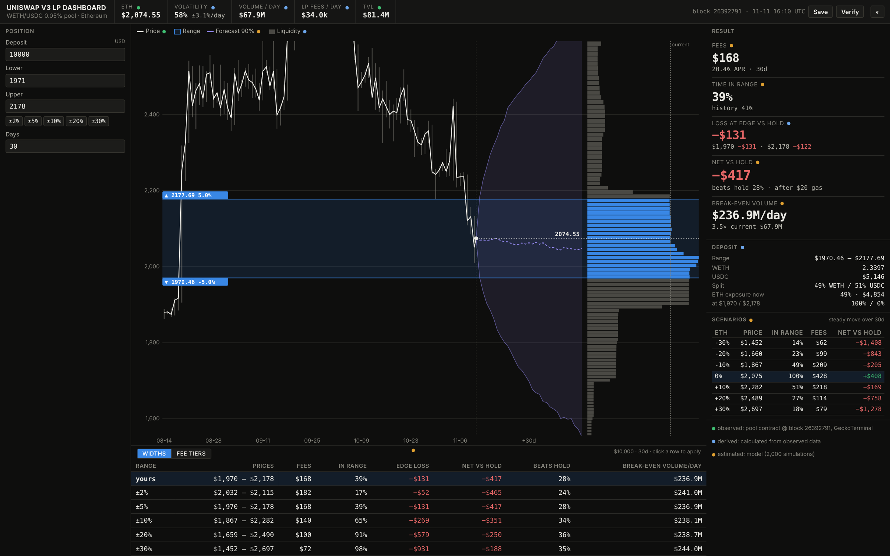

# Uniswap v3 LP Dashboard

A one-screen tool for choosing a Uniswap v3 WETH/USDC liquidity range and fee tier on Ethereum.



- Enter a deposit and a price range.
- See how crowded the range is, expected fees, ETH volatility, how the range did historically, and the result vs just holding.
- Every number is labelled as observed, derived or estimated, with its source.
- Entry decision only: no position monitoring, no trading.
- Main pool: 0.05%, [`0x88e6a0c2ddd26feeb64f039a2c41296fcb3f5640`](https://etherscan.io/address/0x88e6a0c2ddd26feeb64f039a2c41296fcb3f5640). The same range can be compared on the 0.01% and 0.3% pools.

## Web interface

- Hosted: https://hc-hc.github.io/uniswap-v3-lp-dashboard/
- Local: `npm start`, then http://localhost:8787
- Offline: open `dist/index.html` (one self-contained file)

The hosted page is one static file: the data, engine and API all run inside it. It uses snapshots of the 1, 5 and 30 bp pools taken within 15 seconds of each other (block 26,392,791).

## Setup

Node 20+. No dependencies, no API keys.

```
npm start                      # web interface + API at http://localhost:8787
npm run snapshot -- --tier 5   # take a new snapshot (tier 1, 5 or 30)
npm run build:hosted           # rebuild dist/index.html (and docs/index.html for GitHub Pages)
npm run crosscheck             # independent fee estimate for $10k at ±5%
```

## Tests

```
npm test                       # 68 tests, ~3 seconds
```

Calculations:
- Uniswap position maths and tick ↔ price conversion
- liquidity map matches the pool contract
- fee formula and fee share
- simulation (zero volatility gives exact fees)
- model time in range vs history
- break-even volume (plugged back in, gives $0 vs holding)
- scenarios, ETH exposure, fee-tier comparison

Failure cases:
- invalid inputs, range narrower than one tick
- tampered snapshot or bundle
- missing history, volume or ticks
- Ethereum node down, GeckoTerminal rate limit
- on-chain and GeckoTerminal prices disagree
- GeckoTerminal lists the tokens in reverse order
- failed refresh keeps the last good snapshot
- tier comparison across different pairs or duplicate tiers
- unknown routes, oversized requests

## API

The screen is built entirely on the API, so it can be used on its own. Full spec: `GET /api/openapi.json`. Errors return `{ error: { code, message, details } }`.

```bash
# analyse $10k at ±5%
curl -s -X POST localhost:8787/api/analyze -H 'content-type: application/json' \
  -d '{"snapshotId":"latest","inputs":{"capitalUsd":10000,"rangeWidthPct":5}}'

# same range on the 1, 5 and 30 bp pools
curl -s -X POST localhost:8787/api/tiers -H 'content-type: application/json' \
  -d '{"snapshotId":"latest","inputs":{"capitalUsd":10000,"rangeWidthPct":5}}'

# market data behind the screen
curl -s localhost:8787/api/snapshots/latest/market

# save, replay, export
curl -s -X POST localhost:8787/api/analyses -H 'content-type: application/json' \
  -d '{"snapshotId":"latest","inputs":{"capitalUsd":10000,"rangeLower":1960,"rangeUpper":2160}}'
curl -s -X POST localhost:8787/api/analyses/<id>/replay       # → "reproducible": true
curl -s localhost:8787/api/analyses/<id>/bundle > bundle.json  # inputs + data

# live snapshot (keeps the last good one if a source fails)
curl -s -X POST localhost:8787/api/snapshots/refresh
```

Add `> result.json` to any command to save the response.

## Architecture

```
web page  ──►  server.js  ──►  api/router.js  ──►  engine/
hosted page  ─────────────────►  api/router.js  ──►  engine/
providers/live.js (blockchain + GeckoTerminal)  ──►  data/snapshots/  ──►  engine/
```

- `providers/live.js`: takes a snapshot.
  - From the pool contract, at one block: price, active liquidity, fee tier, tick spacing, every tick where liquidity changes.
  - From GeckoTerminal: TVL, 24h volume, 90 days of daily prices and volume.
  - Six checks must pass or the snapshot is rejected.
- `data/snapshots/`: each snapshot is named by a SHA-256 hash of its contents, so edits are detected. `data/raw/` keeps the original captures.
- `engine/`: all the maths, in plain JavaScript with no dependencies (runs on the server and in the browser).
  - `curve.js`: liquidity at each price, rebuilt from ticks
  - `analysis.js`: position, fees, simulation, break-even, scenarios, exposure
  - `tiers.js`: the same range on each fee tier
- `api/`: the API. The server and the hosted page use the same code.
- `public/`: the web page.
- `scripts/crosscheck/`: a standalone fee estimator, kept separate from the engine as an independent check.
- Saved analyses are tied to the snapshot, inputs and code version, so replay gives the identical result.

## Reflections

### How discovery shaped the product

- Uniswap's "new position" screen shows liquidity but no volatility or history, so ranges are picked on gut feel. I added price history, volatility, a forecast range and a historical check next to the liquidity chart.
- Entry decision only, so the tool stops at the preview. No monitoring or execution.
- Fees are split with everyone in the same range, so crowding matters. I rebuilt liquidity from the pool contract and calculate fee share across the whole range.
- The pair trades in 1, 5 and 30 bp pools. Higher tiers pay more per trade but get less volume, and the lowest tier has much less liquidity. So the same range can be run on all three.
- It should fit inside a larger trading system: dense, one screen, most important numbers largest.

### What I learned

- Free data sources disagree a lot: 24h volume ranged from $12.5M to $75.6M across sources on the same day.
- My first version estimated liquidity from a third-party depth table. It was 5× too low, which would have overstated fees 5×. Reading it from the contract fixed this.
- Fees barely change with range width ($72–186 a month on $10k). Width mainly changes the loss when ETH moves.
- At 58% volatility, matching holding needs about 3.5× normal daily volume at any width.
- The 1 bp and 30 bp pools look better (+$381 and +$503 vs −$417 on 5 bp), but mainly because they're 29× and 5× thinner. A snapshot can't see bots adding liquidity around large trades, and the 30 bp pool's average volume is inflated by one $153M day. The tool flags these results instead of showing them as wins.
- GeckoTerminal orders the tokens differently by pool, which flipped the price for two pools until the price check caught it.

### How I validated it

- Six checks on every snapshot: fee tier, tick spacing, contract price vs tick price, on-chain price within 1% of GeckoTerminal, ticks found, ≥30 days of history.
- Rebuilt liquidity matches the contract at today's price, never goes negative, and never exceeds the pool's TVL.
- Fees cross-checked against a standalone estimator that uses a different method (no simulation): $162 vs $168 expected fees for $10k at ±5%, with the same fee share and edge losses (`npm run crosscheck`).
- Simulated time in range (39%) vs history (41%) for ±5%.
- Break-even volume plugged back in gives $0.
- 68 automated tests, including the hosted page giving the same result as the server.

### Assumptions and limitations

- Volume stays at its 30-day average.
- ETH moves randomly at recent volatility with no trend and no jumps, so crash risk is understated.
- Other LPs' liquidity moves with the price.
- No rebalancing, no fee reinvestment, flat $20 gas, no swap costs.
- One chain, one pair, one snapshot per fee tier.
- Fee estimates not yet checked against real positions' earnings.

### Next steps

1. Check fee estimates against real LP earnings (on-chain `Collect` events), per tier.
2. Track fee tiers over time and measure how much liquidity bots take.
3. Hedge with a short ETH perpetual.
4. Rebalancing rules.
5. A price model with larger, more realistic moves.
6. Live monitoring and alerts.
7. More than one data source, with freshness checks.
